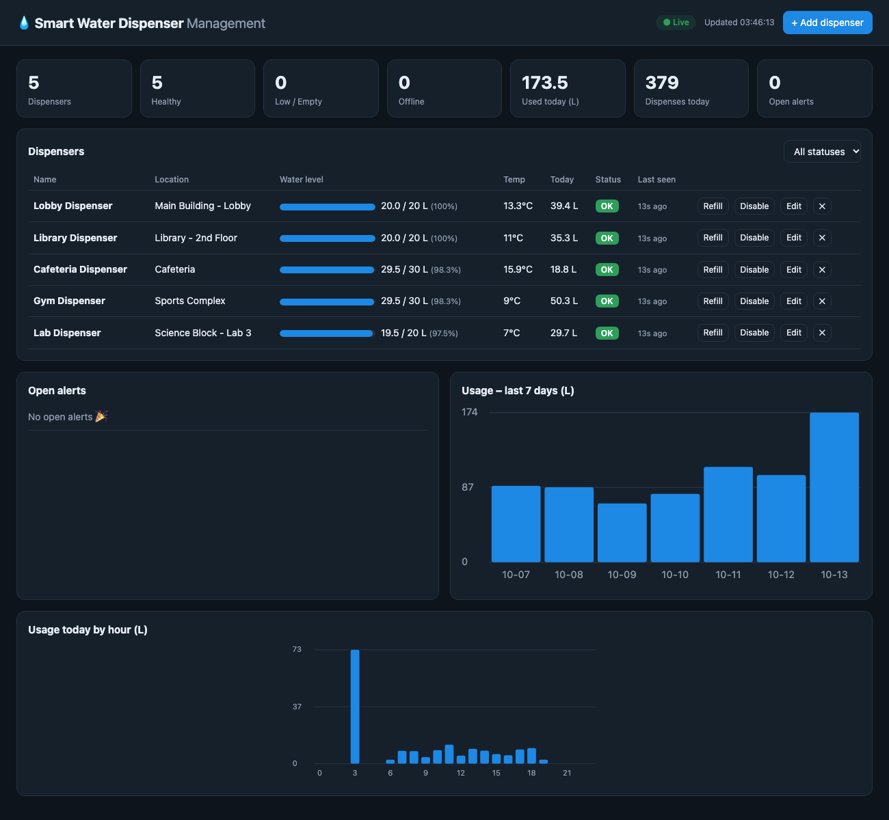

# Smart Water Dispenser Management System

[](https://github.com/vaibhavirawat/smart-water-dispenser/actions/workflows/ci.yml)
Node.js · Express · MySQL · HTML/CSS/JS



A full-stack system for monitoring a fleet of smart water dispensers: devices report water level and temperature to a REST API backed by MySQL, and a live dashboard shows tank levels, usage trends and alerts.

## Features
- Real-time dashboard (auto-refresh every 5 s) with status cards, per-dispenser level bars and usage charts
- Automatic alerts: low level, empty, high temperature, device offline
- Add / edit / disable / delete dispensers, refill, resolve alerts
- Device simulator for demos and testing

## Architecture
```
Devices / simulator ──HTTP──▶ Express REST API ──▶ MySQL
                                   ▲
              Dashboard (HTML/CSS/JS, polls API)
```

## Run
1. Make sure MySQL is running; edit `.env` if your credentials differ.
2. `npm install`
3. `cp .env.example .env` (first time only), then `npm run db:init`  (creates schema + sample data)
4. Create a login: `npm run create-user -- admin admin` (prints a random password once; add a third argument to choose your own). Use role `viewer` for read-only users.
5. `npm start` → http://localhost:3000
6. Optional: `npm run simulate` for live fake traffic.

## REST API
| Method | Path | Purpose |
|---|---|---|
| GET/POST | /api/dispensers | list / create |
| GET/PUT/DELETE | /api/dispensers/:id | read / update / delete |
| POST | /api/dispensers/:id/readings | device heartbeat `{level_l, temperature_c}` |
| POST | /api/dispensers/:id/dispense | log a draw `{volume_ml}` (atomic) |
| POST | /api/dispensers/:id/refill | refill `{added_l?}` |
| GET | /api/dispensers/:id/events | recent dispenses |
| GET | /api/stats, /api/usage/daily, /api/usage/hourly | dashboard data |
| GET | /api/alerts, POST /api/alerts/:id/resolve | alerts |
| GET | /api/health | liveness + DB check |

## Security
- Dashboard login with `admin` (full control) and `viewer` (read-only) roles; the API enforces roles, not just the UI.
- Passwords hashed with scrypt + per-user salt; sessions are HMAC-signed HttpOnly, SameSite=Strict cookies (12 h).
- Login throttling (8 failed attempts / 10 min / IP). Devices use a separate shared `x-api-key`.

## Reliability design
- Connection pool, parameterized queries, input validation.
- Dispense/refill/readings run in transactions with row locks (`FOR UPDATE`), so concurrent draws can't oversell water.
- Status is derived at read time (never stale); alerts are deduplicated and auto-resolve.
- Background job raises OFFLINE alerts when a device stops reporting.
- Dashboard polls every 5s, keeps last good data, and shows a Disconnected pill on failure.
- Graceful shutdown on SIGINT/SIGTERM.

## Run with Docker (one command)
```bash
cp .env.docker.example .env.docker     # then edit the passwords/secret
docker compose --env-file .env.docker up --build
```
Open http://localhost:3000 and sign in with `ADMIN_USERNAME` / `ADMIN_PASSWORD` from `.env.docker`. Compose starts MySQL, waits for it to be healthy, creates the schema, sample data and the first admin, then starts the app. Data persists in a Docker volume; `docker compose down -v` wipes it. The database port is not exposed to the host.

## Tests
```bash
npm test
```
24 integration tests (Node's built-in test runner) run the real app against a throwaway `smart_water_test` database that is created and dropped automatically. They cover login and roles, forged cookies, input validation, dispense/refill logic, alert dedupe and auto-resolve, offline detection, device API-key auth, analytics, cascade deletes, and a concurrency test proving 20 simultaneous dispenses can never overdraw a 5 L tank.

## Real hardware (ESP32)
`firmware/esp32_dispenser/` contains an Arduino sketch that reports real sensor data:

| Sensor | Pin | Purpose |
|---|---|---|
| HC-SR04 ultrasonic | TRIG 5 / ECHO 18 | tank water level |
| DS18B20 | 4 | water temperature |
| YF-S201 flow sensor | 19 | volume dispensed |

1. Set `DEVICE_API_KEY` in `.env` and restart the server.
2. In the sketch set your Wi-Fi, the server's **LAN IP**, the same API key and the dispenser id.
3. Flash with Arduino IDE (libraries: OneWire, DallasTemperature).

The ESP32 sends a reading every 10 s (doubles as a heartbeat, so the dashboard shows it online) and a dispense event whenever water flows. If it stops reporting, an OFFLINE alert is raised.
