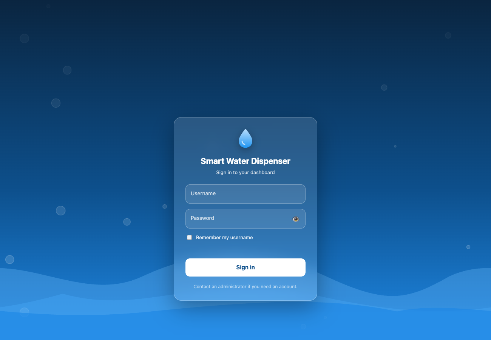
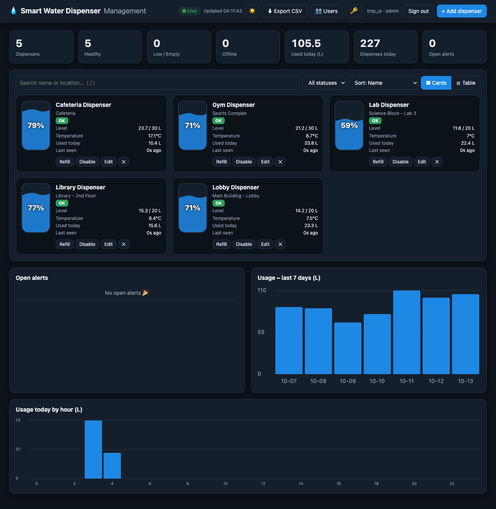
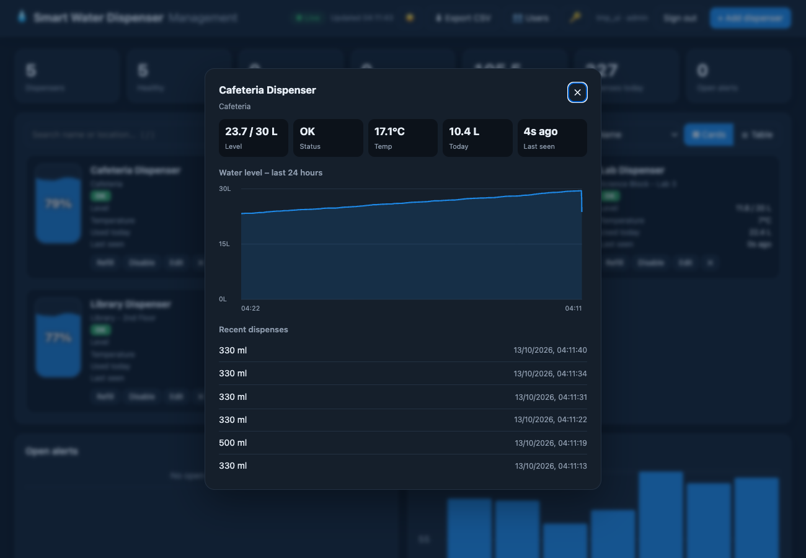
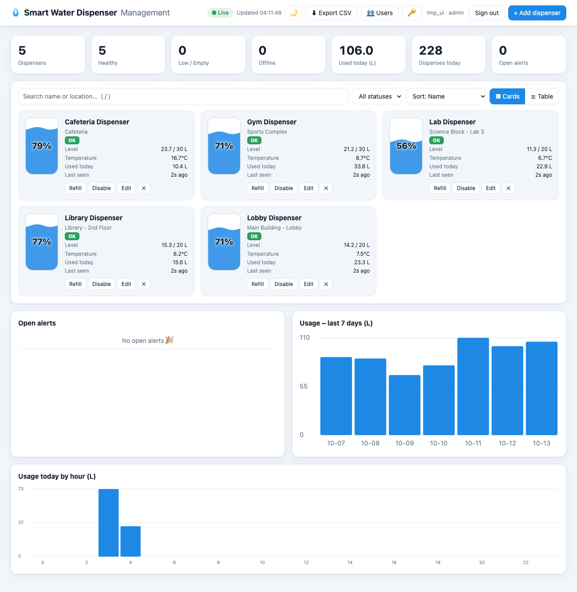

# Smart Water Dispenser Management System

[](https://github.com/vaibhavirawat/smart-water-dispenser/actions/workflows/ci.yml)
Node.js · Express · MySQL · HTML/CSS/JS

## Live demo

**https://smart-water-dispenser-production.up.railway.app**

- **Try it:** open the link, choose **Create account** and sign up with any username and password. New accounts are always **read-only viewers**, so you can explore the dashboard, charts and detail views but can't change anything.
- **Animated data:** the sample dispensers show **OFFLINE** unless a device or the simulator is reporting in. If you see that, the demo is simply idle, and it will come to life when the simulator runs (`npm run simulate`).
- **Hosting note:** it runs on a small hosted plan, so it may be slow to respond after a quiet period or unavailable if the hosting credit runs out. Screenshots below show the full app.
- Want to see the admin side (adding dispensers, managing users)? Run it locally .

<p align="center"></p>
<p align="center"></p>

A full-stack system for monitoring a fleet of smart water dispensers: devices report water level and temperature to a REST API backed by MySQL, and a live dashboard shows tank levels, usage trends and alerts.

## Features
- **Animated login + self sign-up** (Sign in / Create account tabs, password-strength meter, confirm password, show/hide, shake-on-error). New sign-ups are always read-only viewers; set `ALLOW_SIGNUP=false` to turn sign-up off
- **Live dashboard** (auto-refresh every 5 s) with animated water-tank gauges, count-up stats and a cards/table view
- **Dark / light theme**, search (`/` to focus), status filter and sort (name, lowest level, needs attention, most used)
- **Dispenser detail view**: 24-hour level history chart and recent dispenses
- **Automatic alerts**: low level, empty, high temperature, device offline (deduplicated, auto-resolving), with **per-dispenser thresholds** and a **resolved-alerts history**
- **Email alerts** to administrators the moment a new alert opens (30-minute cooldown per dispenser and type; set `ALERT_EMAILS=false` to turn off)
- **Time-to-empty forecast** on every dispenser, from the last 24 hours of usage
- **Accessible and responsive**: keyboard navigation, screen-reader labels, skip link, reduced-motion support, phone layout, loading skeletons
- **Role-based access**: admins manage dispensers and users; viewers get a read-only dashboard
- **Forgot password**: single-use, 1-hour reset links (hashed in the database); changing or resetting a password signs out all other sessions
- **User management** (add, remove, promote/demote) and **change password** from the UI
- **CSV export** of dispense history
- Device simulator, ESP32 firmware, Docker Compose, 61 automated tests, ESLint and CI (Node 20 and 22)

<details><summary>More screenshots</summary>
<p></p>
<p></p>
</details>

## Project layout
```
server.js            app wiring: security headers, static files, routers, background job
src/config.js        environment settings        src/db.js    MySQL pool + transactions
src/http.js          errors, validation helpers  auth.js      scrypt hashing, signed sessions
src/routes/          auth, users, dispensers (+ device API), analytics
src/services/        dispenser status/forecast, alerts, email notifications, analytics queries
public/              dashboard (app.js, style.css) and login page, no inline scripts
test/                helpers.js + accounts, dispensers, features, recovery tests
```

## Architecture
```
Devices / simulator ──HTTP──▶ Express REST API ──▶ MySQL
                                   ▲
              Dashboard (HTML/CSS/JS, polls API)
```

## Run
1. Make sure MySQL is running; edit `.env` if your credentials differ.
2. `npm install`
3. `cp .env.example .env` (first time only), then `npm run db:init`  (creates schema + sample data)
4. Create a login: `npm run create-user -- admin admin` (prints a random password once; add a third argument to choose your own). Use role `viewer` for read-only users.
5. `npm start` → http://localhost:3000
6. Optional live demo traffic: `SIM_USER=admin SIM_PASSWORD=yourpassword npm run simulate`

## REST API
| Method | Path | Purpose |
|---|---|---|
| GET/POST | /api/dispensers | list / create |
| GET/PUT/DELETE | /api/dispensers/:id | read / update / delete |
| POST | /api/dispensers/:id/readings | device heartbeat `{level_l, temperature_c}` |
| POST | /api/dispensers/:id/dispense | log a draw `{volume_ml}` (atomic) |
| POST | /api/dispensers/:id/refill | refill `{added_l?}` |
| GET | /api/dispensers/:id/events | recent dispenses |
| GET | /api/dispensers/:id/history?hours=24 | level history for the detail chart |
| GET | /api/dashboard | stats, dispensers, alerts and usage charts in one call (what the UI polls) |
| GET | /api/stats, /api/usage/daily, /api/usage/hourly | the same data as separate endpoints |
| GET | /api/dispensers/:id/refills | recent refills |
| GET | /api/export/events.csv?days=30 | CSV download |
| GET/POST/DELETE | /api/users (admin) | user management |
| POST | /api/auth/login, /register, /logout, /password · GET /api/auth/me, /config | authentication |
| PUT | /api/users/:username/role (admin) | promote / demote |
| GET | /api/alerts, POST /api/alerts/:id/resolve | alerts |
| GET | /api/health | liveness + DB check |

## Security
- Dashboard login with `admin` (full control) and `viewer` (read-only) roles; the API enforces roles, not just the UI.
- Passwords hashed with scrypt + per-user salt; sessions are HMAC-signed HttpOnly, SameSite=Strict cookies (12 h).
- Every request re-checks the user in the database, so removed users and role changes take effect immediately.
- Security headers (CSP, nosniff, frame denial, HSTS when HTTPS), same-origin API, `Secure` cookies via `COOKIE_SECURE`.
- Reset links are built from `BASE_URL`, never the request's Host header; the reset endpoint never reveals whether an account exists.
- CSV export neutralises spreadsheet formula injection.
- Login throttling (8 failed attempts / 10 min / IP); sign-ups limited to 5 / hour / IP (`SIGNUP_LIMIT`). Self-registration can never create an admin. Devices use a separate shared `x-api-key`.

## Reliability design
- Connection pool, parameterized queries, input validation.
- Dispense/refill/readings run in transactions with row locks (`FOR UPDATE`), so concurrent draws can't oversell water.
- Status is derived at read time (never stale); alerts are deduplicated and auto-resolve.
- Background job raises OFFLINE alerts when a device stops reporting.
- Dashboard polls every 5s, keeps last good data, and shows a Disconnected pill on failure.
- Graceful shutdown on SIGINT/SIGTERM.

## Run with Docker (one command)
```bash
cp .env.docker.example .env.docker     # then edit the passwords/secret
docker compose --env-file .env.docker up --build
```
Open http://localhost:3000 and sign in with `ADMIN_USERNAME` / `ADMIN_PASSWORD` from `.env.docker`. Compose starts MySQL, waits for it to be healthy, creates the schema, sample data and the first admin, then starts the app. Data persists in a Docker volume; `docker compose down -v` wipes it. The database port is not exposed to the host.

## Deploy
See [DEPLOY.md](DEPLOY.md) for putting it online with HTTPS (Railway + managed MySQL), email setup for password reset and a security checklist.

## Tests and linting
```bash
npm test        # 61 integration tests
npm run lint    # ESLint
```
The integration tests (Node's built-in test runner, one file per area in `test/`) run the real app against throwaway `smart_water_test_<area>` databases that are created and dropped automatically, so they run in parallel and never touch your data. They cover login and roles, forged cookies, input validation, dispense/refill logic, alert dedupe and auto-resolve, offline detection, device API-key auth, analytics, cascade deletes, and a concurrency test proving 20 simultaneous dispenses can never overdraw a 5 L tank.

## Real hardware (ESP32)
`firmware/esp32_dispenser/` contains an Arduino sketch that reports real sensor data:

| Sensor | Pin | Purpose |
|---|---|---|
| HC-SR04 ultrasonic | TRIG 5 / ECHO 18 | tank water level |
| DS18B20 | 4 | water temperature |
| YF-S201 flow sensor | 19 | volume dispensed |

1. Set `DEVICE_API_KEY` in `.env` and restart the server.
2. In the sketch set your Wi-Fi, the server's **LAN IP**, the same API key and the dispenser id.
3. Flash with Arduino IDE (libraries: OneWire, DallasTemperature).

The ESP32 sends a reading every 10 s (doubles as a heartbeat, so the dashboard shows it online) and a dispense event whenever water flows. If it stops reporting, an OFFLINE alert is raised.
